# mini-drone · 自制 ESP32-S3 微型四轴

<p align="center">
  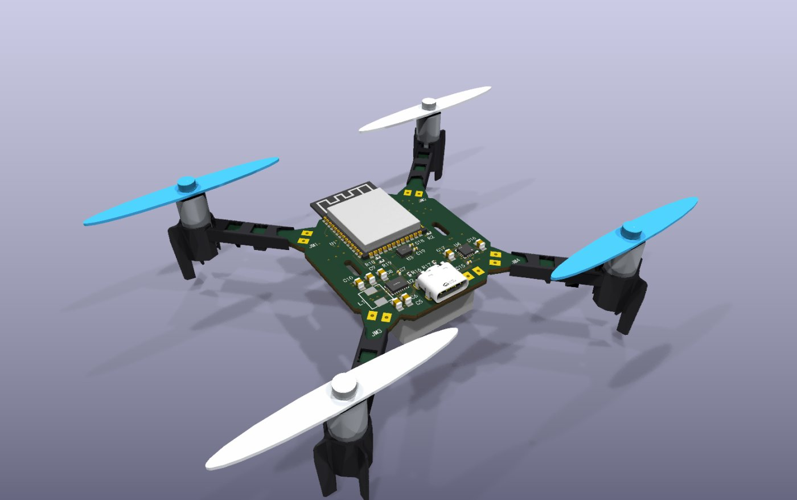
</p>

从电路板到飞控固件再到电脑调试台，全部自己做的一架 **38 g、1S 锂电、空心杯电机** 的小四轴。
板子用 ESP32-S3 + 六轴 IMU，固件 Arduino 写，WiFi 无线调参、无线刷固件，电脑网页上一键起飞，飞完自动出黑匣子和录像分析。

| | |
|---|---|
| 主控 | ESP32-S3-WROOM-1-N8R2（8 MB Flash / 2 MB PSRAM，WiFi） |
| 姿态 | QMI8658A 六轴 IMU，250 Hz 卡尔曼融合 |
| 电源 | 1S 锂电，TPS63020 升降压 3.3 V，BQ24073 USB-C 充电 |
| 电机 | 4 路 CJ3400 低边 MOSFET 驱动空心杯 |
| 整机 | 37.8 g（含桨） |
| 固件 | `flight-v11`：角度/角速度串级 PID、偏航补偿、重心补偿自学、推算位置保持 |

---

## 硬件

<table>
<tr>
<td width="50%">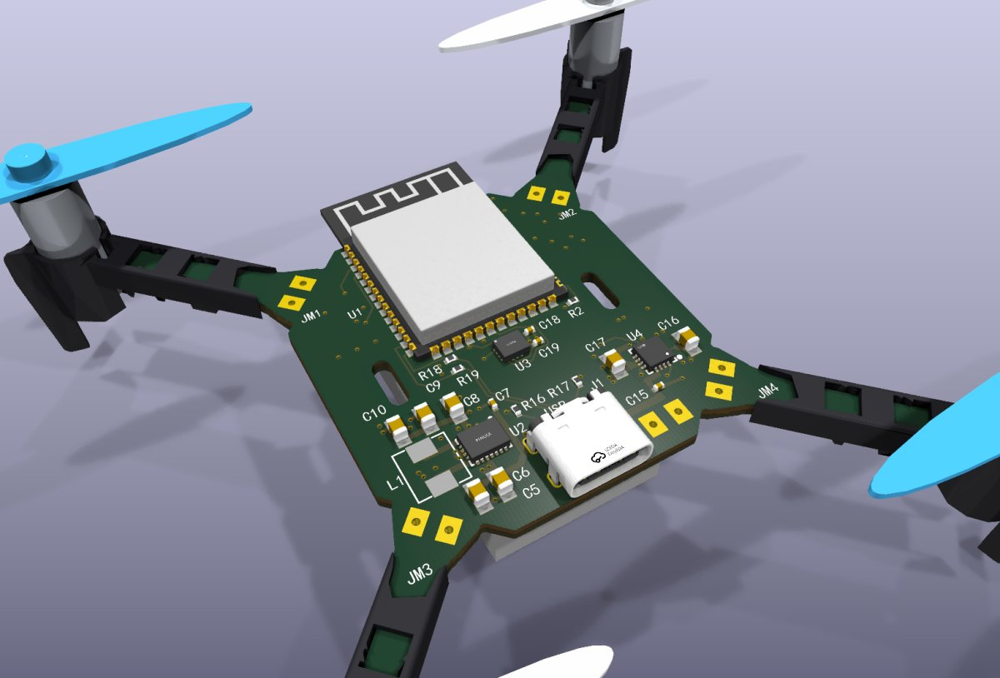</td>
<td width="50%">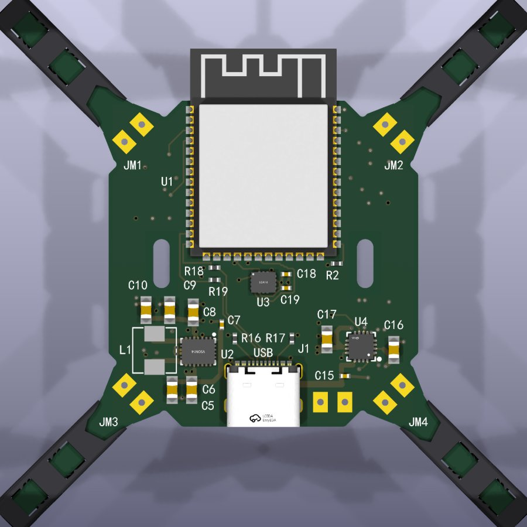</td>
</tr>
<tr>
<td align="center">PCB 3D（含电机座、桨）</td>
<td align="center">正面：U1 主控、U2 电源、U3 IMU、U4 充电、J1 USB-C</td>
</tr>
<tr>
<td>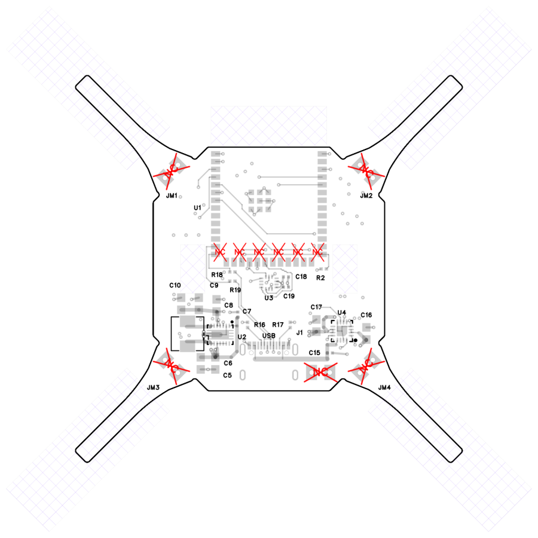</td>
<td>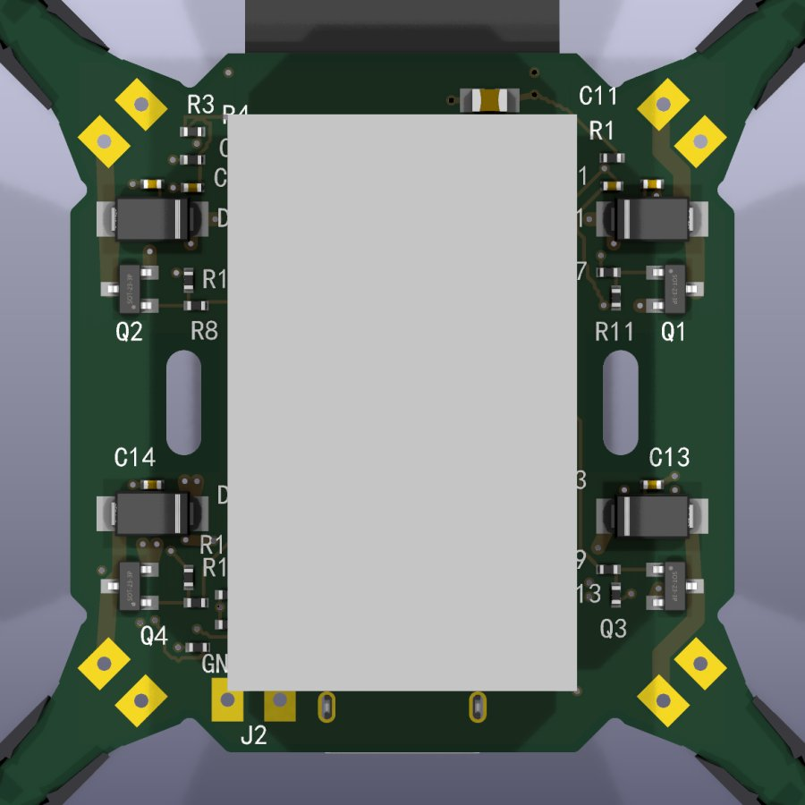</td>
</tr>
<tr>
<td align="center">顶层丝印 / 走线</td>
<td align="center">背面：Q1–Q4 电机 MOS、D1–D4 续流、电池</td>
</tr>
</table>

**原理图**（点开看大图，PDF：[schematic.pdf](docs/hardware/schematic.pdf)）

<a href="docs/img/schematic.png">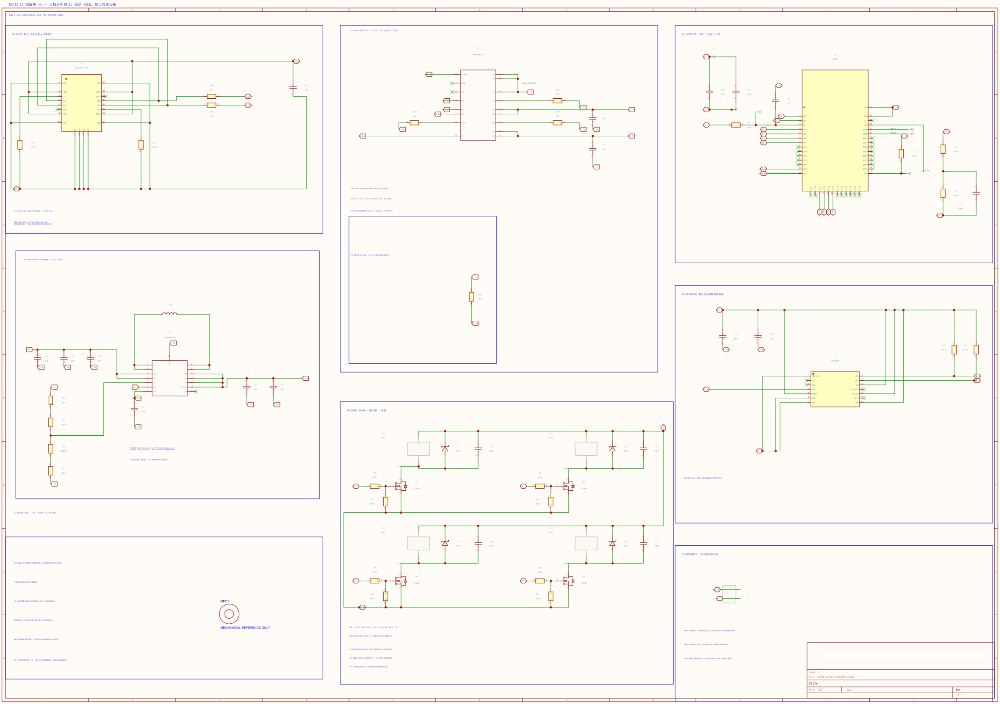</a>

> 3D 渲染用 KiCad 从资料包里的 v5 工程生成，和实板有小差别（板框圆角等）；接线以原理图、PCB PDF 为准。

PCB 各层：[pcb.pdf](docs/hardware/pcb.pdf)（6 页：装配图、BOM、顶层、底层等）· 硬件说明与引脚表：[docs/hardware/硬件说明.md](docs/hardware/硬件说明.md) · KiCad 工程、Gerber、BOM、贴片坐标：`pack/` 资料包里的 `06_hardware`。

### 主要器件

| 位号 | 型号 | 作用 |
|---|---|---|
| U1 | ESP32-S3-WROOM-1-N8R2 | 主控 + WiFi |
| U2 | TPS63020DSJR | 升降压 DC-DC，电池 3.0–4.2 V 全程稳 3.3 V |
| U3 | QMI8658A | 六轴 IMU（I2C 0x6B） |
| U4 | BQ24073RGTR | USB 充电 + 系统供电（实测 189 mA） |
| Q1–Q4 | CJ3400 | 电机低边开关（330 Ω 栅极串阻 + 100 k 下拉） |
| D1–D4 | SS34 | 电机续流 |
| J1 | USB-C 16P | 充电、串口、刷固件 |

### 引脚

| 功能 | GPIO | | 功能 | GPIO |
|---|---|---|---|---|
| 电机 M1（前左） | 4 | | IMU SDA | 10 |
| 电机 M2（前右） | 5 | | IMU SCL | 11 |
| 电机 M3（后左） | 6 | | 电池电压 ADC | 2 |
| 电机 M4（后右） | 7 | | USB 插入检测 | 9（低有效） |

电机驱动是低边斩波：`VBAT ── 电机 ── Qx ── GND`，只能单向转，正反桨对角配对抵消反扭。

---

## 电脑调试台

浏览器打开就能用，WiFi 连飞机（也能插 USB），每一步只有必要的按钮。

<table>
<tr>
<td width="50%">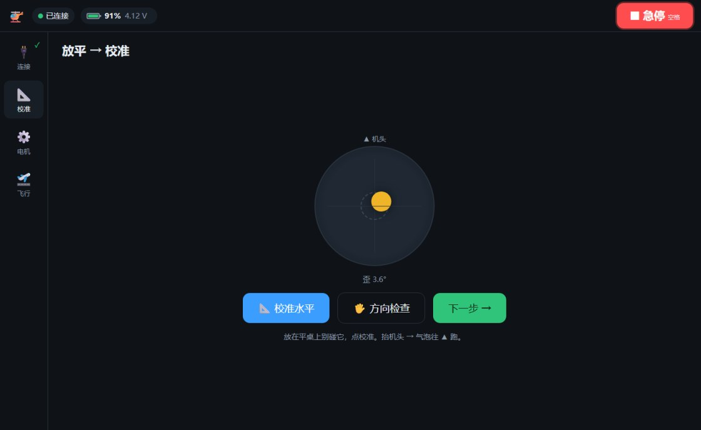</td>
<td width="50%">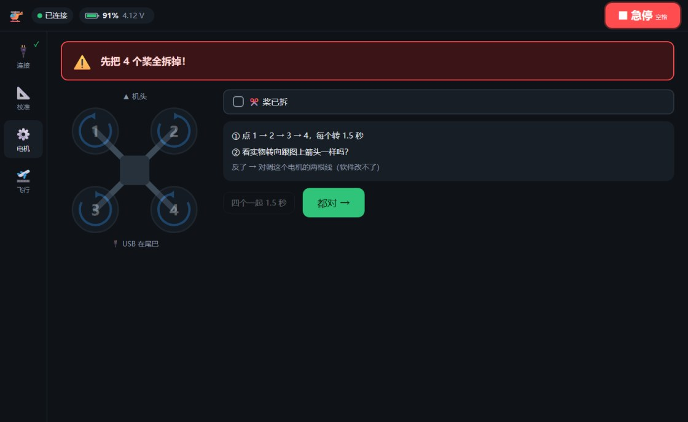</td>
</tr>
<tr>
<td align="center">① 放平校准 + 方向检查（自动算 IMU 安装角）</td>
<td align="center">② 拆桨点动电机，看转向</td>
</tr>
<tr>
<td>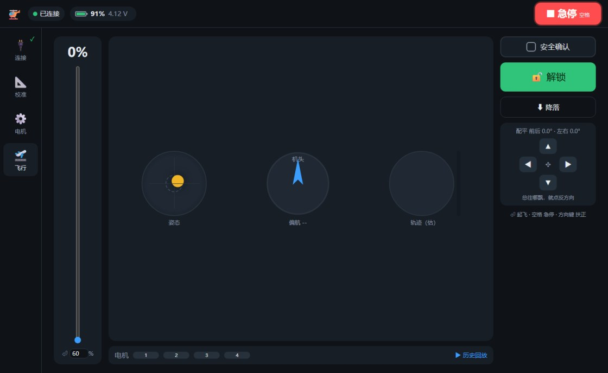</td>
<td>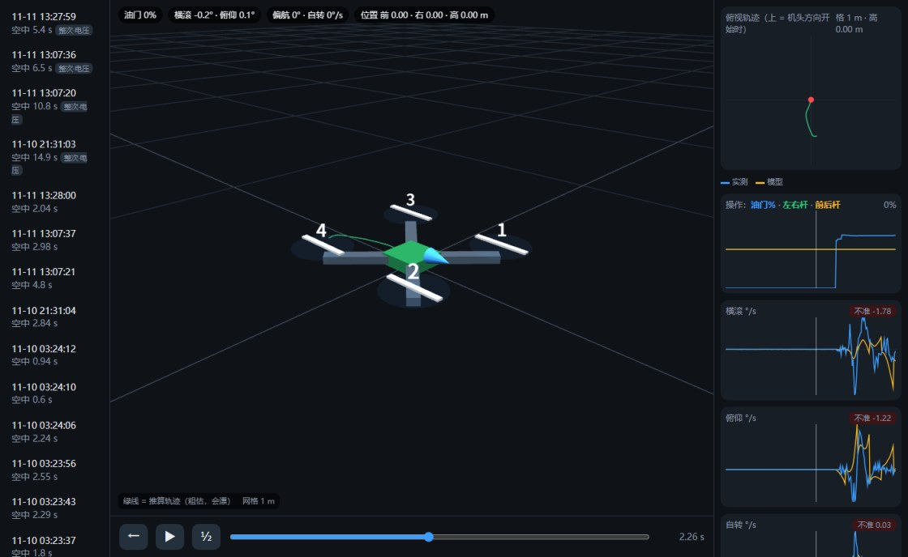</td>
</tr>
<tr>
<td align="center">③ 飞行：Enter 一键起飞、空格急停、配平四键、姿态/偏航/轨迹仪表</td>
<td align="center">④ 历史回放：3D 小飞机按黑匣子重放 + 推算轨迹 + 各通道曲线</td>
</tr>
</table>

- 顶栏：电量 %、电压、预计充满时间、WiFi 信号格
- 控制走 UDP 25 Hz（独立任务，网页服务卡了也不掉线），页面失焦 / 0.4 s 没心跳自动停
- 每次上锁自动存：飞机里 250 Hz 黑匣子（最后 4.8 s）+ 电脑端整次记录（25 Hz）+ 摄像头录像
- “⬆ 更新固件”无线 OTA

---

## 飞行数据：用录像校验飞控的“自我感觉”

解锁时电脑自动用摄像头录像，`tools/video_track.py` 在画面里追踪飞机，算出实际跑了多远。

<table>
<tr>
<td width="45%">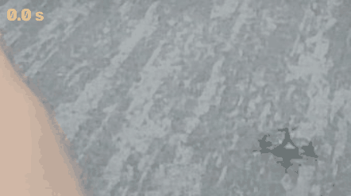</td>
<td width="55%">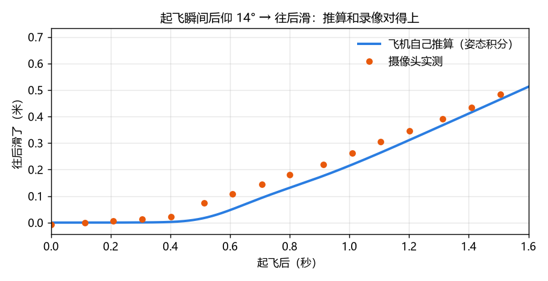</td>
</tr>
<tr>
<td align="center">起飞后往后滑（绿线 = 追踪轨迹）</td>
<td align="center">飞机用姿态积分推算的位移，和摄像头实测几乎重合</td>
</tr>
</table>

找到的原因：重心偏 3/4 号电机一侧，飞控在地上把积分清零，一离地重的一边推力不够 → 后仰 14° → 带着 0.5 m/s 往后滑。
对应改进：

- **v10 重心补偿**：起飞前就把积分放成学到的偏置 bR/bP，每次飞完电脑按悬停数据自动再学
- **v11 推算位置保持**：飞行中用姿态积分出速度和位移，反向倾斜刹车、慢慢拉回起飞点（仿真：5 s 漂移 1.9 m → 0.2 m）

### 固件演进

| 版本 | 内容 |
|---|---|
| v2 | WiFi AP+STA、mDNS、无线刷固件、串口长行修复 |
| v3 | UDP 控制/遥测独立任务 |
| v4 | 地面不积分、黑匣子 250 Hz |
| v5 | IMU 安装角 `rot`（实测 -90°，之前一直翻的根因） |
| v6–v7 | 偏航控制、电机偏航测试 |
| v8 | 两状态卡尔曼（角度 + 陀螺零偏）、电压补油门、空中自动测偏航方向 |
| v9 | 角度外环积分，消长期静差 |
| v10 | 重心补偿 bR/bP + 自学 |
| v11 | 推算速度刹车 + 回原点 |

---

## 快速开始

1. 装 Python 3.10+：`pip install pyserial numpy opencv-python`
2. 双击 `启动调试台.bat`，浏览器打开 http://127.0.0.1:8771/
3. 页面自动连飞机（先 WiFi，后 USB）。没飞机想看界面：`fly.html?mock`

### 编译固件

```bash
python tools/make_v2.py <资料包>/01_firmware/flight_v1/flight_v1.ino firmware/flight_v11/flight_v11.ino
arduino-cli compile --fqbn esp32:esp32:esp32s3:CDCOnBoot=cdc,FlashSize=8M,PSRAM=enabled,PartitionScheme=min_spiffs,USBMode=hwcdc --output-dir firmware/build firmware/flight_v11
```

然后在调试台点“⬆ 更新固件”无线刷入（esp32 core 3.3.x）。

## 目录

| 路径 | 内容 |
|---|---|
| `fly.html` / `replay.html` | 调试台、历史回放 |
| `drone_server.py` | 本地服务：WiFi/UDP/USB 连接、黑匣子、整次记录、OTA、重心补偿自学 |
| `cam_rec.py`、`tools/video_track.py` | 自动录像、录像追踪 |
| `firmware/flight_vN/` | 各版固件源码（由 `tools/make_v2.py` 生成），`firmware/build/` 编译产物 |
| `flights/` | 全部飞行记录 |
| `docs/` | 原理图、PCB、图片 |
| `pack/` | 完整资料包：KiCad 工程、Gerber、BOM、最早的固件和网页 |
| `backup/` | 刷 v2 前的整片固件备份和原参数 |
| `交接.md` | 全部开发记录和踩过的坑 |

## 安全

没拆桨别点电机；空格 = 急停；飞行时页面失焦会自动停。
