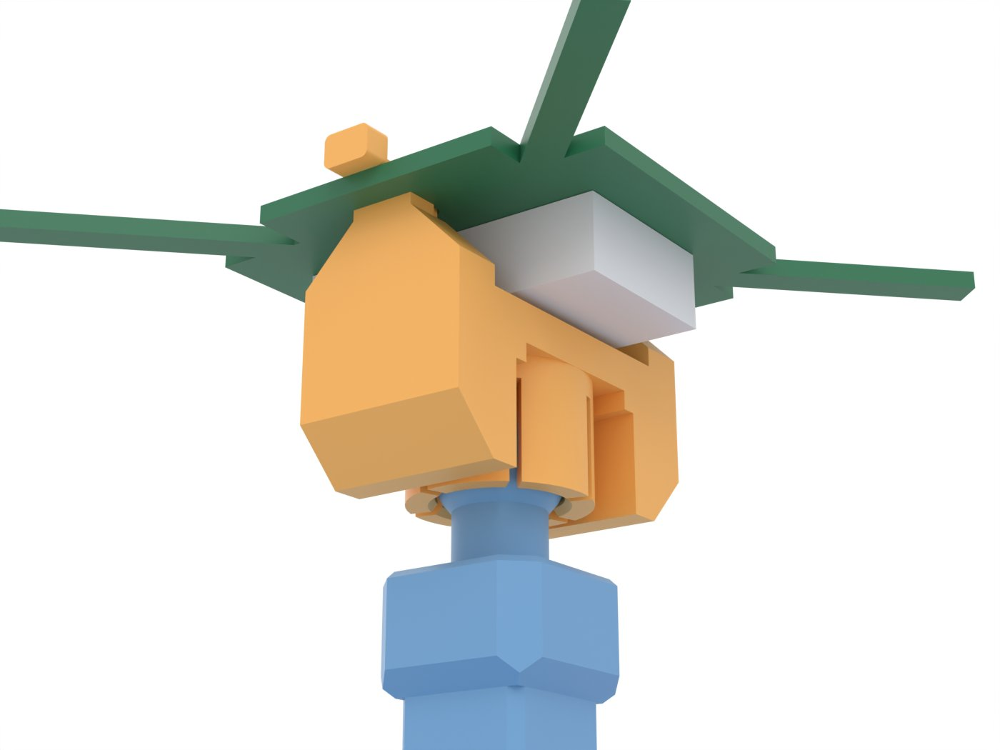
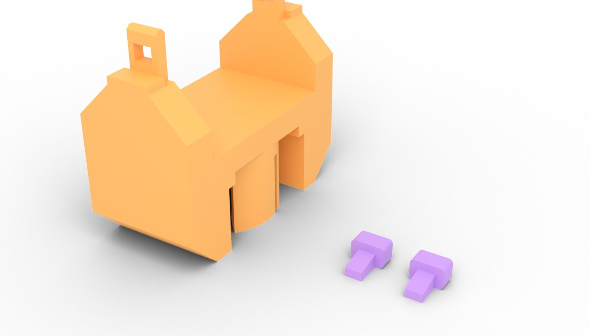
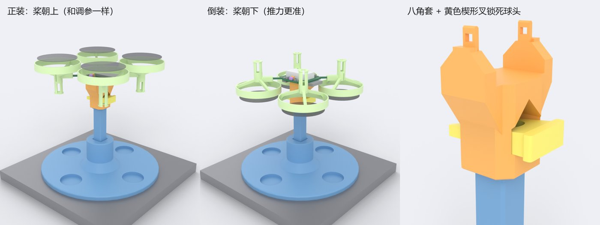
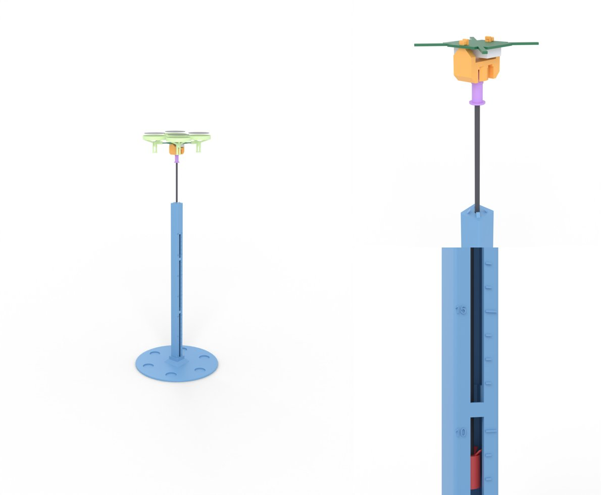

# 调参测试架（纯 3D 打印）

<p align="center"></p>

把飞机扣在球头上，带桨推油门调横滚 / 俯仰 / 偏航：三轴都放开，飞不走、翻不了，桨离架子和桌面都很远。
**不用轴承、螺丝、胶水、扎带，全部不加支撑打印**：托架的两根硬片从下面穿过 PCB 中间两条长槽，正面露出来的横孔里各插一根插销，把板子夹住。

| | |
|---|---|
| 转动 | 球铰，三轴全放开（偏航不限圈） |
| 限位 | 卡口下沿碰球颈：1 号 ±23° / 2 号 ±20° / 3 号 ±17°（固件倾角保护 55°，不会误触发） |
| 固定飞机 | 硬片穿长槽 + 斜面插销压住 PCB 正面，垫台顶住背面；电池不受力 |
| 球心高度 | 离桌面 100 mm；倾到限位时飞机最低点离桌面约 82 mm |
| 重心 | 球心在电池正下方，整机重心在球心上方约 21 mm（见下） |
| 底座 | Ø150 mm，4 个压重物的坑（Ø26，放硬币/螺母），胶带直接贴圆盘边 |

<table>
<tr>
<td width="50%"></td>
<td width="50%"></td>
</tr>
<tr>
<td align="center">两根硬片穿过 PCB 长槽，插销插进横孔压住正面</td>
<td align="center">从下面看：球窝在正中，横梁两头 45° 斜撑（立着打不用支撑）</td>
</tr>
<tr>
<td></td>
<td></td>
</tr>
<tr>
<td align="center">打印摆放：托架立着（球窝口贴床），插销平放，都不要支撑</td>
<td align="center">侧面剖视</td>
</tr>
</table>

## 改版记录

- **11-18 v4.1**（用户试装：托架顶到电池推不到底，横孔露不出来、插销进不去）：电池下面的空隙 0.8 → 3 mm（PCB 背面到横梁共 10 mm，电池 10 mm 以内都行）；硬片多伸出来：横孔下沿比 PCB 正面低 0.4、上沿高 1.75，上面再留 2 mm；插销改成 3.5 mm 短楔子（1.2 → 1.9 厚），头顶到硬片就停，尖端不会戳到模组。代价：重心在球心上方从 19 变 21 mm。
- **11-18 v4 托架 + 插销**（用户：卡钩倒钩太大塞不进、也难拔；要两件式、不加支撑）：实板长槽照片量出来宽约 2.0、长约 5.4（KiCad 是 6）。
  - 托架：两根**硬片**（1.6 × 4.2，不用弯，不会断）穿长槽，露出 PCB 正面的部分开 2.6 × 1.3 横孔，孔底和 PCB 正面齐平；硬片下段和垫台连成一整块。
  - 插销：扁楔子，从外往里推进横孔，越推越紧，把 PCB 压在垫台上（v4.1 已改短，见上）。
  - 托架立着打（球窝口贴床），横梁两头加 45° 斜撑落到床面，所以不用支撑；悬空的只剩球窝内顶和横孔顶，都是 2.6 mm 以内的小跨度，能直接搭过去。
- **11-18 v3 / v3.1**：一体弹性卡钩，实测倒钩太大塞不进（已废弃）。
- **11-18 v2**：球窝卡口加直壁更紧（原来倒角把卡口吃掉了）、紧度试件 1/2/3 号；删掉导向鳍、单轴卡扣、底座三角肋和胶带耳。立柱 `post.stl` 一直没变，不用重打。

## 要打的文件

| 文件 | 数量 | 材料 | 摆放 | 层高 | 墙 / 填充 | 支撑 | 约重 |
|---|---|---|---|---|---|---|---|
| `stl/holder_2.stl` 托架（球窝 2 号紧度） | 1 | PETG / PLA | **原样立着：球窝口贴床**，加 3 mm brim | 0.16 | 4 墙 / 40% | 不要 | 8 g |
| `stl/key.stl` 插销 | **2** | PETG / PLA | 原样平放 | 0.12 | 全实心 | 不要 | <1 g |
| `stl/post.stl` 立柱 + 球头（已打过就不用） | 1 | PETG / PLA | 竖着，球朝上 | 0.16 | 4 墙 / 40% | 不要 | 10 g |
| `stl/base.stl` 底座（已打过就不用） | 1 | PLA | 原样平放 | 0.2–0.28 | 3 墙 / 15% | 不要 | 55 g |

- 球窝紧度挑了 1 号或 3 号试件，就打 `holder_1.stl` / `holder_3.stl`。没挑就用 2 号。
- 托架立着打时，球窝的打印方向和之前的托板、试件反过来了（这次口朝下），紧度可能差一点：太紧就换 1 号，太松换 3 号。
- 插销多打两根备用，很小。

### 可改参数（`stand.py` 顶部，改完 `python stand.py` 重新生成）

| 参数 | 默认 | 作用 |
|---|---|---|
| `TAB_T` / `TAB_HX` | 1.6 / 2.1 | 硬片厚 / 半宽（实板槽宽 2.0、长 5.4）；插不进槽就减小 |
| `WIN_HX` / `WIN_BOT` / `WIN_TOP` | 1.3 / -0.4 / 1.75 | 横孔半宽 / 下沿 / 上沿（相对 PCB 正面）：插销太松就减小 `WIN_TOP` |
| `KEY_T0` / `KEY_T1` / `KEY_L` | 1.2 / 1.9 / 3.5 | 插销尖端厚 / 根部厚 / 楔子长：插到底还晃就加大 `KEY_T1` |
| `SNAP` / `SNAP_TESTS` | 0.50 / (0.35, 0.50, 0.65) | 球窝卡口比球小（单边），越大越紧、限位越小 |
| `BAT_H` / `BAT_GAP` | 7 / 3.0 | 电池厚 / 电池下面留的空隙：还顶电池就加大 `BAT_GAP` |
| `NECK_R` | 4.09 | 球颈半径，已打印立柱的尺寸，别改 |

## 怎么装、怎么拆

1. **底座**：坑里放硬币或螺母压重，圆盘边用胶带贴住桌面。立柱压进方孔到底。
2. **托架装到飞机上**：托架前后左右对称，不分方向。两根硬片对准 PCB 背面中间那两条长槽，从下往上推到底（垫台顶住 PCB 背面），横孔从 PCB 正面露出来。
3. **插插销**：两根插销分别从左右**外侧往中间**推进横孔（细的一头先进），推到推不动或者头顶到硬片为止。
4. **扣到球头上**：球窝对准球头往下按，“咔”一声。
5. **拆**：捏住插销的头往外抽出来，托架往下一拉就下来了。

## 调参时注意

- 首次上架先**拆桨**，在调试台点电机确认方向，再装桨。
- 油门推到悬停附近（现在约 65–70%）就够；推力超过重量时球窝会被往上拉，别长时间满油门。
- **重心比球心高约 21 mm**：倾 10° 时重力额外产生约 1.8 mN·m“往下倒”的力矩，大约相当于四个电机各差 10% 推力。所以架上会比真飞**略爱倒**，再加上球铰有摩擦，参数在架上调稳后，真飞时一般是“偏稳”的一侧。
- 元件位置是按 v5 KiCad 算的，实板可能略有不同：装之前看一眼背面两条长槽外侧（垫台顶的位置）和正面槽边（插销压的位置）有没有元件。

## 重新生成

```bash
pip install cadquery trimesh
python stand.py            # 生成 stl/*.stl 和 stl/assembly/（装配体，看效果用）
python stand.py --check    # 碰撞检查：托架+插销 vs PCB/电池/元件；限位前 1° 不碰 / 过限位 1.5° 全碰；最低点
python side_view.py ../docs/img/stand_side.png
blender -b -P render_blender.py -- stl/assembly <输出目录>   # 渲染图
```

尺寸来源：机架从 `ref/motor_mount_guard_20261115.step`（11-15 新电机座+保护圈，Ø53.4 × 37 mm）量；PCB 外形、长槽、元件位置从资料包 v5 KiCad 工程量，长槽长度按实板照片改成 5.4。
`--check` 当前结果（2 号）：托架、插销和 PCB、电池、元件都不重叠（离背面 D3/D4 0.5 mm，其余 ≥1 mm）；19° 时 24 个方向都不碰，21.5° 全碰；倾到限位时飞机最低点离桌面 81.9 mm。

## 推力测试柱 v2（厨房秤，卡扣固定，不用胶）


飞机倒过来（桨朝下、电池朝上）锁在柱顶，整套平放在厨房秤上，去皮后单独转一个电机，读数就是这个电机的推力。

- **文件**：`stl/thrust_post_v2.stl`（柱子和底座一体）+ `stl/key.stl` ×2（插销，和调参测试架通用）。源文件 `thrust_post.py`。
- **怎么锁飞机**：和调参测试架 v4.1 同一套。柱顶两根硬片从 PCB 正面穿过两条长槽，从背面冒出来；两根插销从左右外侧往中间推进横孔，把 PCB 夹在柱顶的垫台上。ESP32 模组落在浅口袋里只防晃，不受力。
- **怎么放秤上**：底座是 Ø110 × 4 的平圆盘，直接平放在秤盘正中（盘子 ≥120 mm 都放得下），4 个坑里各放一枚 1 元硬币压重。为什么不做夹秤盘的卡夹：秤盘厚度、边缘形状各家不一样，卡夹不通用；电机推力是往下压的，作用点离中心约 49 mm，在 Ø110 底盘范围内，不会翻也不会滑，平放加配重最简单、最稳。
- **高度**：倒过来以后最低点（保护圈顶）离秤盘 40 mm，进气不挡。
- **碰撞检查**（`python thrust_post.py --check`，倒置姿态）：PCB、电池、电机座、桨都不碰；模组口袋留 0.15 mm 间隙；正面 C9/C10 离垫台约 0.7 mm，其余元件都在 1 mm 以上。
- **打印**：柱子原样立着打（底盘贴床），PLA，0.2 mm 层高，3 墙，15% 填充，不要支撑，约 30 g、1.5 小时左右；插销平放，0.12 层高，打实心，不要支撑。
- **装**：
  1. 飞机倒过来，PCB 中间两条长槽对准柱顶的两根硬片，往下压到底（模组落进口袋）；
  2. 两根插销从左右外侧往中间推进硬片上的横孔，推到推不动；
  3. 整套放到秤盘正中，坑里放硬币，去皮。拆的时候把插销往外抽出来。

## 推力刚性连接件（装在调参测试架立柱上，测单电机推力）



不另打推力柱：调参测试架的**立柱、底座不动**，只把球窝托架换成这个连接件，飞机就被锁死在柱顶（横滚/俯仰/偏航都不能动），整架放厨房秤上去皮，单转一个电机看读数变化。推力柱 v2 可以不打。

- **怎么锁死**：连接件下半截是一个八角套，套住立柱球头下面那块 16 mm 八角块（间隙 0.15，偏航锁死）；套子里顶是 45° 锥面压在球顶上，再从机头方向横插一把**黄色楔形叉**，U 形口跨过球颈、托住球底，越推越紧，把球上下夹死。上半截和飞机的连接与 v4.1 托架完全一样（两根硬片穿长槽 + 两根插销，同一个 `key.stl`）。
- **两种装法**（下半截一样，只是上半截不同，两件都打）：
  - `rigid_up` **正装**（桨朝上，和调参一样）：桨离底座盘面 137 mm（3 倍桨径），但 Ø150 底座整个在桨下面，**下洗打在底座上，底座又在秤上，等于抵掉一部分推力，读数会明显偏小**（估计只剩真实值的一半到八成）。四个电机受的影响差不多，**只能比相对强弱**，用来算补偿还行。
  - `rigid_inv` **倒装**（桨朝下，飞机倒挂在柱顶）：风往上吹，底座和秤都不挡风，下面只有进气，**读数基本就是真实推力，更准，推荐用这个**。最低点（保护圈）离桌面 96 mm，桨离立柱、底座都远。
- **要不要压硬币**：不用。整架约 150 g（底座 84 + 立柱 10 + 连接件 6 + 飞机 49）。正装时四个电机全开也就 ~50 g 往上拉，拉不起来；单个电机想把整架掀翻的力矩只有自重扶正力矩的 1/7。倒装时推力往下压，更不会动。秤盘放得下 Ø150 底座就行。
- **碰撞检查**（`python rigid.py --check`）：正装和 v4.1 托架一样（背面 D3/D4 0.5 mm，其余 ≥1.3 mm）；倒装和推力柱 v2 一样（模组口袋 0.15、C9/C10 0.7 mm）；连接件、叉和立柱名义位置不重叠；叉再往里推 3.5 mm 才碰到球颈（还能多夹 0.4 mm，球打大打小都能锁紧）。

**一键打印（Bambu Lab A1）**：打开 `test_stand/推力连接件_A1.3mf`，一盘黑色 PLA：正装件 + 倒装件 + 楔形叉 ×2（一把备用），约 21 g、1.1 小时（`python rigid.py --3mf` 生成，命令行切片通过、没有悬空警告）。都不要支撑：两个连接件八角口朝下立着打（4 墙 40%），叉平放（实心）。插销用已有的两根。

**怎么装**：
1. 先把飞机上的球窝托架拆下来（抽出两根插销），把托架从球头上拔掉。
2. 连接件按 v4.1 托架的方法装到飞机上：两根硬片穿进 PCB 中间两条长槽，推到底，两根插销从左右外侧推进横孔。倒装就用 `rigid_inv`，飞机翻过来，硬片从模组那面穿，插销插在电池那面。
3. 连接件的八角口对准立柱顶的八角块（4 个方向都能套，机头朝哪都行），套下去压到底，球头进到锥顶里。
4. 黄色叉子从机头方向（套子侧面那个尖顶的横孔）水平插进去，U 形口跨过球颈，用手指推到推不动、飞机晃不动为止。拆的时候把叉子往外拔。
5. 整架放秤盘正中，去皮，单转一个电机读数：正装读数变小、倒装读数变大，变化量就是推力。

## 定高测试架（导杆上下滑，测高度控制）



飞机坐在一根轻导杆顶上，导杆在一根竖直空心塔里穿两个导向孔上下滑，**行程 30 cm**；杆顶球铰让横滚/俯仰活动 **±15°**，偏航不限（可以一直转）。飞不走、翻不了，桨离塔最近也有 3 cm。

- **为什么是“导杆跟着飞机动”**：固定导杆会从飞机中间穿过去；把导杆挪到桨外面又得用长悬臂，滑块会被别住卡滞。让导杆跟飞机一起走，受力全在杆的轴线上，上下两个导向孔（间距 65 mm）只受很小的侧力，摩擦最小。
- **软限位**：最低时球头底下的法兰落在塔顶 4 片斜弹性片上；最高时杆底红色限位环上的 4 片弹性片顶到塔里第二个导向孔，导杆拔不出来，飞机飞不走。
- **刻度**：塔正面开观察窗，旁边印 0–30 cm 刻度，看红色限位环的上沿读高度（= 飞机比最低位置高多少）；手机录像或摄像头追踪都行。
- **跟着飞机一起动的重量**约 11 g（托架 4.6 + 球头 2 + 限位环 1.2 + 碳管 3.4），比要求的 8 g 多，架上悬停油门会比真飞高一些；最重的是托架，按下表用 2 墙 10% 打。

**一键打印（Bambu Lab A1）**：直接打开 `test_stand/定高测试架_A1.3mf`，已经摆好两盘（`python make_plates.py` 生成，命令行切过两盘都成功）：
- 盘 1（AMS 1 号黑色 PLA）：底座 + 三节塔 + 球头 + 插销 ×2，约 167 g、4.4 小时；
- 盘 2（AMS 4 号黄色 PETG）：杆底限位环 + 托架（2 墙 10%），约 5 g、40 分钟。
A1 右后角（缠料检测区）没放东西；各零件的墙数/填充已经按对象设好。

**要买 / 找的现成件**：Ø4 碳纤维管/碳杆剪 400 mm 一根（实心 Ø4 碳杆约 7.8 g，比空心管重 4 g）（推荐 4×3 薄壁，约 3.4 g；4×2 也行，约 5.8 g）。没有的话用 Ø4、40 cm 的烧烤竹签（不够直，摩擦大一点）。导杆粗细不是 4 mm 就改 `alt_stand.py` 里的 `ROD_D` 重新生成。底座上另外放 6 枚 1 元硬币，最好再压一本书。

| 文件 | 数量 | 摆放 | 层高 | 墙 / 填充 | 支撑 |
|---|---|---|---|---|---|
| `stl/alt_base.stl` 底座 Ø200 | 1 | 平放 | 0.2–0.28 | 3 墙 / 15% | 不要 |
| `stl/alt_tower_1/2/3.stl` 塔（每节 13–14 cm） | 各 1 | 原样立着 | 0.2 | 3 墙 / 15% | 不要 |
| `stl/alt_ball.stl` 杆顶球头 | 1 | 竖着，球朝上 | 0.12 | 3 墙 / 20% | 不要 |
| `stl/alt_collar.stl` 杆底限位环（用红色等醒目颜色） | 1 | 原样，弹性片朝上 | 0.12 | 3 墙 / 20% | 不要 |
| `stl/holder_2.stl` 托架（测试架那个，已打过可直接用） | 1 | 立着，球窝口贴床 | 0.16 | **2 墙 / 10%**（减重） | 不要 |
| `stl/key.stl` 插销（已打过可直接用） | 2 | 平放 | 0.12 | 实心 | 不要 |

材料 PLA 就行，弹性片用 PETG 更耐用。

**怎么装**：
1. 塔第 1 节插进底座方孔，第 2、3 节依次插上（下面一节顶上的榫插进上面一节，观察窗都朝同一面）。底座坑里放硬币。
2. 先把第 3 节（最上面那节）拿下来：导杆从它顶上的孔往下穿，穿过里面第二个导向孔，从下口露出来后套上红色限位环（弹性片朝上，压到导杆最底端）；然后把第 3 节连同导杆一起插回第 2 节上。
3. 球头套到导杆顶上压到底。
4. 托架用两根插销锁在飞机上（和调参测试架一样），再把托架的球窝按到球头上，“咔”一声。

调参：起飞后看刻度窗里红环的位置就是高度；先用小油门让飞机在 5–10 cm 处悬停，再试定高。
