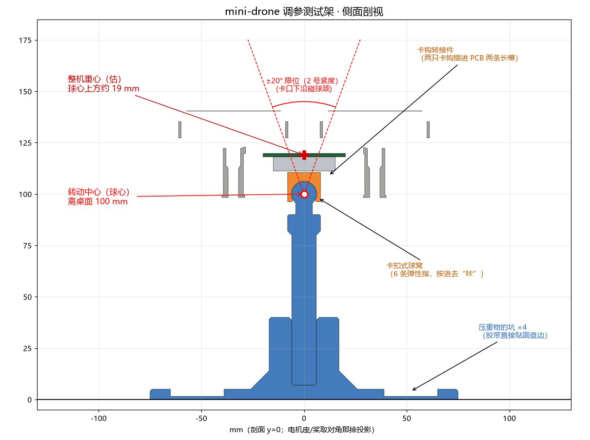
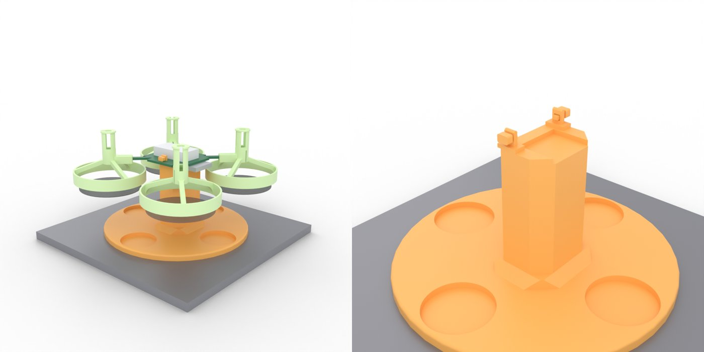

# 调参测试架（纯 3D 打印）

<p align="center"></p>

把飞机扣在球头上，带桨推油门调横滚 / 俯仰 / 偏航：三轴都放开，飞不走、翻不了，桨离架子和桌面都很远。
**不用轴承、螺丝、胶水、扎带**：3 个打印件，飞机靠两只卡钩直接插进 PCB 中间的两条长槽，“咔”一下就装好。

| | |
|---|---|
| 转动 | 球铰，三轴全放开（偏航不限圈） |
| 限位 | 卡口下沿碰球颈：1 号 ±23° / 2 号 ±20° / 3 号 ±17°（固件倾角保护 55°，不会误触发） |
| 固定飞机 | 两只弹性卡钩穿 PCB 长槽，倒钩压住正面、垫台顶住背面，把 PCB 夹住；电池不受力 |
| 球心高度 | 离桌面 100 mm；倾到限位时飞机最低点离桌面约 80 mm |
| 重心 | 球心在电池正下方，整机重心在球心上方约 19 mm（见下） |
| 底座 | Ø150 mm，4 个压重物的坑（Ø26，放硬币/螺母），胶带直接贴圆盘边 |

<table>
<tr>
<td width="50%"></td>
<td width="50%"></td>
</tr>
<tr>
<td align="center">两只卡钩从下往上穿过 PCB 中间的长槽，倒钩压住正面</td>
<td align="center">从下面看：横梁正中是球窝，两头是卡钩和顶住 PCB 背面的垫台</td>
</tr>
</table>



## 改版记录

- **11-18 v3 卡钩直插**（用户：不想用热熔胶、要结实）：连飞机那一件重做成 `adapter_clip_N.stl`。
  - 卡钩：钩臂厚 1.5（长槽宽 2.0，两边各留 0.25），穿槽部分宽 4.4（槽直段 ±2，两头 R1），倒钩伸出槽外沿 0.6 mm，倒钩下沿比 PCB 正面高 0.1 mm；上面 45° 导入斜面，再往上 3 mm 是捏手。
  - 加固：钩臂从横梁底板起弯，有效长约 11 mm（应变约 1.2%，PETG/PLA 都在弹性范围内）；根部两侧 45° 加强楔；球窝整圈和 16 mm 宽的横梁连成一体，再加一圈加强楔；横梁厚 3.5。
  - **侧躺打印**：钩臂平躺在床上，弯的时候受力沿着走线方向，不靠层与层之间的粘合，不容易断。
  - 碰撞检查（`--check`，按 v5 KiCad 的元件位置）：模组 2.8 mm、电感 4.8、USB-C 10、电池 0.85、背面二极管 D3/D4 0.5 mm、其余阻容 ≥1.4 mm；垫台只在长槽旁边 ±3 mm 宽一条，避开背面元件。
- **11-18 v2**：球窝卡口加直壁更紧（原来倒角把卡口吃掉了）、紧度试件 1/2/3 号；删掉导向鳍、单轴卡扣、底座三角肋和胶带耳。立柱 `post.stl` 一直没变，不用重打。

## 要打的文件

| 文件 | 材料 | 摆放 | 层高 | 墙 / 填充 | 支撑 | 约重 |
|---|---|---|---|---|---|---|
| `stl/adapter_clip_2.stl` 卡钩转接件（2 号紧度） | **PETG**（PLA 也行） | **已侧躺摆好，别让切片软件自动旋转**；加 5 mm 裙边/brim | 0.12–0.16 | 4 墙 / 100% | 不要 | 5 g |
| `stl/post.stl` 立柱 + 球头 | PETG / PLA | 竖着，球朝上 | 0.16 | 4 墙 / 40% | 不要 | 10 g |
| `stl/base.stl` 底座 | PLA | 原样平放 | 0.2–0.28 | 3 墙 / 15% | 不要 | 55 g |
| `stl/socket_test_N.stl` 紧度试件 | 同转接件 | 圆片贴床 | 0.12 | 4 墙 / 100% | 不要 | 2 g |

- 紧度：如果试件挑了 1 号或 3 号，就打 `adapter_clip_1.stl` / `adapter_clip_3.stl`（球窝分别和 1、3 号试件一样）。没挑就用 2 号。
- 侧躺打印时球窝是横着的，球窝顶上会有一点点下垂；扣不上或太紧就换松一号的。
- 钩子顶端有约 6 mm 长的一小段悬空，Bambu 不开支撑也能打，底面稍毛不影响。

### 可改参数（`stand.py` 顶部，改完 `python stand.py` 重新生成）

| 参数 | 默认 | 作用 |
|---|---|---|
| `SNAP` / `SNAP_TESTS` | 0.50 / (0.35, 0.50, 0.65) | 卡口比球小（单边），越大越紧、限位越小 |
| `FIT` | 0.20 | 球窝比球大（单边） |
| `ARM_T` | 1.5 | 钩臂厚：插不进槽就减小，太软就加大（不超过 1.7） |
| `BARB` | 0.6 | 倒钩伸出槽外沿：太难插减小，容易掉加大 |
| `BARB_CLR` | 0.1 | 倒钩下沿到 PCB 正面的间隙：晃就改 0，卡不进去改 0.2 |
| `BAT_H` / `BAT_GAP` | 7 / 0.8 | 电池厚 / 电池下面留的空隙（电池更厚就加大 `BAT_H`） |
| `NECK_R` | 4.09 | 球颈半径，已打印立柱的尺寸，别改 |

## 怎么装、怎么拆

1. **底座**：坑里放硬币或螺母压重，圆盘边用胶带贴住桌面。立柱压进方孔到底。
2. **装飞机**：转接件前后左右对称，不分方向。两只卡钩对准 PCB 背面中间那两条长槽，从下往上推，“咔”两声，倒钩从 PCB 正面露出来压住板子。
3. **扣到球头上**：球窝对准球头往下按，“咔”一声。
4. **拆飞机**：在 PCB 正面用两根手指把两只卡钩的捏手**往中间捏**（各捏进约 1 mm），同时把转接件往下拉。

## 调参时注意

- 首次上架先**拆桨**，在调试台点电机确认方向，再装桨。
- 油门推到悬停附近（现在约 65–70%）就够；推力超过重量时球窝会被往上拉，别长时间满油门。
- **重心比球心高约 19 mm**：倾 10° 时重力额外产生约 1.6 mN·m“往下倒”的力矩，大约相当于四个电机各差 10% 推力。所以架上会比真飞**略爱倒**，再加上球铰有摩擦，参数在架上调稳后，真飞时一般是“偏稳”的一侧。
- 元件位置是按 v5 KiCad 算的，实板可能略有不同：装之前看一眼背面两条长槽外侧（垫台顶的位置）有没有元件。

## 重新生成

```bash
pip install cadquery trimesh
python stand.py            # 生成 stl/*.stl 和 stl/assembly/（装配体，看效果用）
python stand.py --check    # 碰撞检查：转接件 vs PCB/电池/元件；限位前 1° 不碰 / 过限位 1.5° 全碰；最低点
python side_view.py ../docs/img/stand_side.png
blender -b -P render_blender.py -- stl/assembly <输出目录>   # 渲染图
```

尺寸来源：机架从 `ref/motor_mount_guard_20261115.step`（11-15 新电机座+保护圈，Ø53.4 × 37 mm）量；PCB 外形、长槽、元件位置从资料包 v5 KiCad 工程量。
`--check` 当前结果（2 号）：转接件和 PCB、电池、元件都不重叠；19° 时 24 个方向都不碰，21.5° 全碰；倾到限位时飞机最低点离桌面 79.9 mm。

## 推力测试加高柱（厨房秤用）



飞机倒过来（桨朝下、电池朝上）架在柱子上，柱子用热熔胶粘在秤盘上，读数变化 = 推力。

- 文件：`stl/thrust_post.stl`（源文件 `thrust_post.py`），一根直方柱（30×20.5，前面两棱倒角），Ø44 平底，高 57.6 mm，原样立着打。
- 怎么托：ESP32 模组压在托台的浅口袋里（主承力）；两根小销插进 PCB 中间那两条长槽，肩台托住槽边，飞机不会滑、不会后仰。不用夹，推力本来就把飞机往下压；不放心就用扎带穿托台下面的横孔，绕过机身扎一圈。
- 高度：倒置后最低点（保护圈顶）离秤盘 40 mm。托台前端收短了，离前面两个电机座的辐条 4.5 mm，碰不到桨。
- 打印：PLA，0.2 mm 层高，3 墙，20% 填充，不要支撑，约 15 g、45 分钟左右。
- 粘：底面有十字浅槽，热熔胶打在底面再压到秤盘中心。先放上飞机、去皮，再推油门读数。
