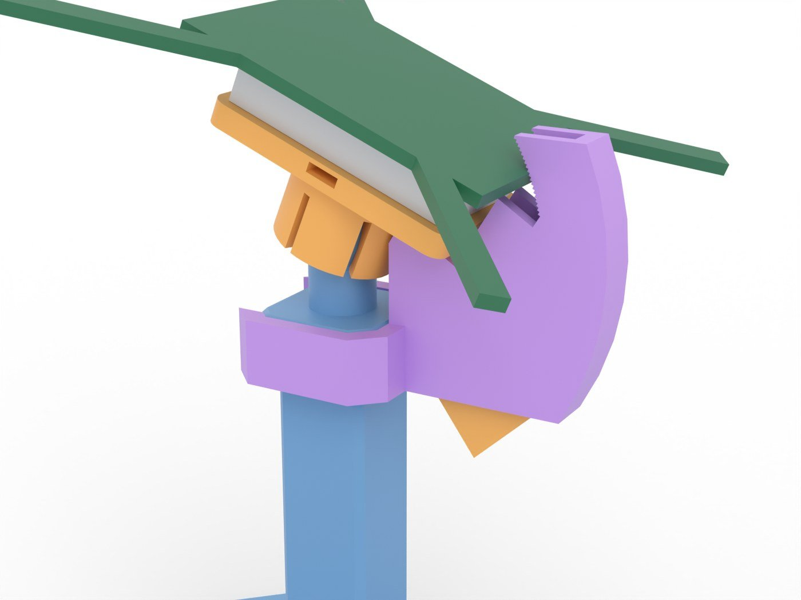

# 调参测试架（纯 3D 打印）

<p align="center"></p>

把飞机扣在球头上，带桨推油门调横滚/俯仰：飞不走、翻不了（各方向限位 ±30°），桨离架子和桌面都很远。
**不用轴承、不用螺丝**：4 个打印件 + 1 根皮筋（或细扎带）。

| | |
|---|---|
| 转动 | 球铰：三轴全放开（偏航不限圈）；装上卡扣只剩俯仰或横滚 |
| 限位 | 球窝下沿碰球颈，任意方向 ±30°（固件倾角保护 55°，不会误触发） |
| 球心高度 | 离桌面 100 mm；倾到 30° 时飞机最低点离桌面 71 mm |
| 重心 | 球心在电池正下方，整机重心在球心上方约 18 mm（见下） |
| 底座 | Ø150 mm，4 个压重物的坑（Ø26，放硬币/螺母）+ 4 个胶带耳 |
| 打印 | 约 75 g 料，无支撑 |

<table>
<tr>
<td width="50%"></td>
<td width="50%"></td>
</tr>
<tr>
<td align="center">单轴模式：紫色卡扣的导槽夹住托板下的鳍，只能俯仰</td>
<td align="center">零件：底座、立柱（带球头）、卡扣、托板（带球窝）</td>
</tr>
</table>


## 零件和打印

| 文件 | 材料 | 摆放 | 层高 | 墙 / 填充 | 支撑 | 约重 |
|---|---|---|---|---|---|---|
| `stl/base.stl` 底座 | PLA | 原样平放 | 0.2–0.28 | 3 墙 / 15% | 不要 | 55 g |
| `stl/post.stl` 立柱 + 球头 | PETG（PLA 也行） | **竖着，球朝上** | 0.16 | 4 墙 / 40% | 不要 | 10 g |
| `stl/adapter.stl` 托板 + 球窝 | **PETG** | **已翻好：托板贴床、球窝口朝上** | 0.12–0.16 | 4 墙 / 100% | 不要 | 4 g |
| `stl/lock.stl` 单轴卡扣 | PETG / PLA | 原样平放 | 0.16 | 3 墙 / 100% | 不要 | 4 g |

- 球窝的 6 根弹性指要掰开 0.3 mm 才能扣上，PETG 不容易断；PLA 打也可以，先少掰几次试。
- 球头下半球有约 45° 的小悬垂，个别打印机会有点毛，用砂纸转两圈就行。球和球窝里抹一点铅笔芯粉/硅脂，转动更顺。

### 配合公差（都在 `stand.py` 顶部，打出来紧/松就改这几个数重新生成）

| 参数 | 默认 | 作用 |
|---|---|---|
| `FIT` | 0.25 | 球窝比球大（单边），转不动就加大 |
| `SNAP` | 0.30 | 卡口比球小（单边），扣不上就减小，太松会被推力拔出就加大 |
| `HOLE_CLR` | 0.4 | 底座方孔比方柱大；孔里有 4 条挤压筋，插紧不晃 |
| `CLIP_CLR` | 0.15 | 卡扣和八角块的间隙 |
| `LOCK_GAP` | 0.35 | 导槽两侧间隙（单轴模式另外两轴的空程约 1–2°，抬头到底时约 4°） |
| `BAT_L/W/H` | 30/16/7 | **电池长/宽/厚，先量自己的改**（H = PCB 底面到电池底面） |
| `PIVOT_H` | 100 | 球心离桌面高度 |
| `TILT_MAX` | 30 | 限位角，改了球颈粗细会自动算 |

## 怎么装

1. **底座**：坑里放硬币或螺母压重，四个耳朵用胶带贴住桌面。立柱压进方孔到底。
2. **托板装到飞机上**：托板顶面贴电池底，**刻的箭头朝机头**。皮筋（或细扎带）从 PCB 背面两条长槽穿下来，穿过托板里的横孔，再从板子上面绕回来拉紧（绕在 ESP32 模组上方，避开 USB）。
3. **三轴模式**：球窝对准球头往下按，"咔"一声。取下：捏住托板往上拔。
4. **单轴模式**：先不装飞机，把卡扣**从机头方向**水平推到球头下的八角块上（咔）= 只能俯仰；**从飞机左侧**推上 = 只能横滚。再按第 3 步装飞机，托板下的鳍要落进卡扣的导槽里。换轴：拔飞机 → 拔卡扣转 90° → 重装。

## 调参时注意

- 首次上架先**拆桨**，在调试台点电机确认方向，再装桨。
- 油门推到悬停附近（现在约 65–70%）就够，这样纠正余量和真飞一样；推力超过重量时球窝会被往上拉，卡口能扛住，但别长时间满油门。
- **重心比球心高约 18 mm**（电机座 16 g 重心在 PCB 上方 6 mm，电池在下方）：倾 10° 时重力额外产生约 1.5 mN·m 的“往下倒”的力矩，大约相当于四个电机各差 10% 推力。所以架上会比真飞**略爱倒**，再加上球铰有摩擦，参数在架上调稳后，真飞时一般是“偏稳”的一侧，P 可以再往上试。
- 球心放不进 PCB 平面：电池正好在中间挡着，球铰只能在电池下面。想要转动中心正好在重心，得做外框万向节，转动惯量会涨很多（外环十几克），反而失真，所以没这么做。

## 重新生成

```bash
pip install cadquery trimesh
python stand.py            # 生成 stl/*.stl 和 stl/assembly/（装配体，看效果用）
python stand.py --check    # 碰撞检查：三轴 29° 不碰 / 31.5° 碰；单轴锁住另外两轴；最低点
python side_view.py ../docs/img/stand_side.png
blender -b -P render_blender.py -- stl/assembly <输出目录>   # 渲染图
```

尺寸来源：机架从 `ref/motor_mount_guard_20261115.step`（11-15 新电机座+保护圈，Ø53.4 × 37 mm）量；PCB 外形、绑带槽位置从资料包 KiCad 工程量（机臂端点离中心 43.8 mm，电机中心约 48.7 mm）。
`--check` 当前结果：三轴 29° 时 24 个方向都不碰，31.5° 全碰；单轴模式另外两轴转 3° 都被挡；倾到 30° 时飞机最低点离桌面 70.7 mm。

## 推力测试加高柱（厨房秤用）


飞机倒过来（桨朝下、电池朝上）架在柱子上，柱子用热熔胶粘在秤盘上，读数变化 = 推力。

- 文件：`stl/thrust_post.stl`（源文件 `thrust_post.py`），一根直方柱（30×20.5，前面两棱倒角），Ø44 平底，高 57.6 mm，原样立着打。
- 怎么托：ESP32 模组压在托台的浅口袋里（主承力）；两根小销插进 PCB 中间那两条长槽，肩台托住槽边，飞机不会滑、不会后仰。不用夹，推力本来就把飞机往下压；不放心就用扎带穿托台下面的横孔，绕过机身扎一圈。
- 高度：倒置后最低点（保护圈顶）离秤盘 40 mm。托台前端收短了，离前面两个电机座的辐条 4.5 mm，碰不到桨。
- 打印：PLA，0.2 mm 层高，3 墙，20% 填充，不要支撑，约 15 g、45 分钟左右。
- 粘：底面有十字浅槽，热熔胶打在底面再压到秤盘中心。先放上飞机、去皮，再推油门读数。
