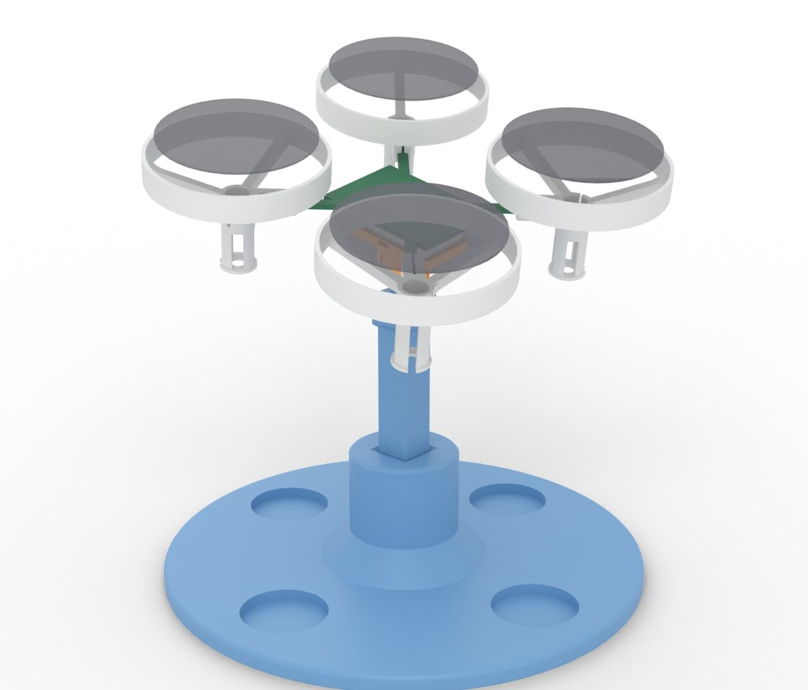
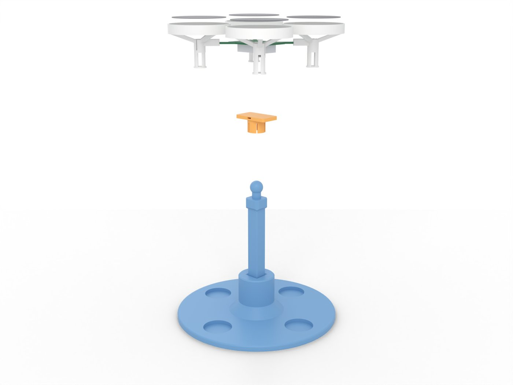
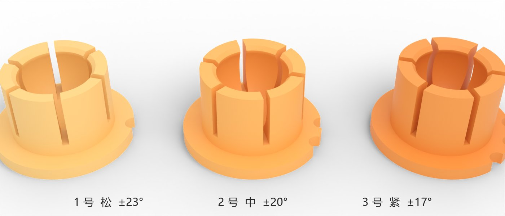

# 调参测试架（纯 3D 打印）

<p align="center"></p>

把飞机扣在球头上，带桨推油门调横滚 / 俯仰 / 偏航：三轴都放开，飞不走、翻不了，桨离架子和桌面都很远。
**不用轴承、不用螺丝**：3 个打印件 + 1 根皮筋（或细扎带）。

| | |
|---|---|
| 转动 | 球铰，三轴全放开（偏航不限圈） |
| 限位 | 卡口下沿碰球颈：1 号 ±23° / 2 号 ±20° / 3 号 ±17°（固件倾角保护 55°，不会误触发） |
| 球心高度 | 离桌面 100 mm；倾到限位时飞机最低点离桌面约 79 mm |
| 重心 | 球心在电池正下方，整机重心在球心上方约 18 mm（见下） |
| 底座 | Ø150 mm，4 个压重物的坑（Ø26，放硬币/螺母），胶带直接贴圆盘边 |
| 打印 | 约 70 g 料，无支撑 |

<table>
<tr>
<td width="50%"></td>
<td width="50%"></td>
</tr>
<tr>
<td align="center">托板背面的卡扣式球窝扣在球头上</td>
<td align="center">零件：底座、立柱（带球头）、托板（带球窝）</td>
</tr>
</table>


## 11-18 改版（试装反馈）

- **球窝太松、容易掉**：原来卡口下面的倒角把卡口“吃”掉了，实际只卡住约 0.17 mm。现在卡口下面先留一圈 0.3 mm 直壁再倒角，卡多少就是多少；间隙 0.25 → 0.2。
- **凸出的细支架全删**：托板下两片导向鳍、单轴卡扣（`lock.stl` 不要了）、底座三角肋（换成凸台根部一圈锥台）、胶带耳。
- 立柱 `post.stl` **没变，不用重打**（球颈 Ø8.18 保持不变）。代价：卡口越紧，下沿越早碰到球颈，限位角从 30° 变成 17–23°。

## 先打试件挑紧度



`stl/socket_test_1/2/3.stl`：只有球窝那一小段，圆片边上的缺口数 = 号数，每个约 2 g、十来分钟。

| 号 | 卡口比球小（单边） | 限位 | 对应托板 |
|---|---|---|---|
| 1 | 0.35 mm | ±23° | `stl/adapter_1.stl` |
| 2 | 0.50 mm | ±20° | `stl/adapter_2.stl` |
| 3 | 0.65 mm | ±17° | `stl/adapter_3.stl` |

挑法：三个都扣到已打好的球头上——
1. 能用手指按进去（“咔”一声），不用老虎钳；
2. 扣上后拎着试件甩一甩、往上轻拉，不掉；
3. 转起来还顺（不卡顿、不发涩）。

选满足这三条里**最紧**的那个，打对应号的托板。都太松 / 都太紧就告诉我，再出一组。

## 零件和打印

| 文件 | 材料 | 摆放 | 层高 | 墙 / 填充 | 支撑 | 约重 |
|---|---|---|---|---|---|---|
| `stl/base.stl` 底座 | PLA | 原样平放 | 0.2–0.28 | 3 墙 / 15% | 不要 | 55 g |
| `stl/post.stl` 立柱 + 球头 | PETG（PLA 也行） | **竖着，球朝上** | 0.16 | 4 墙 / 40% | 不要 | 10 g |
| `stl/adapter_N.stl` 托板 + 球窝 | **PETG** | **已翻好：托板贴床、球窝口朝上** | 0.12 | 4 墙 / 100% | 不要 | 4 g |
| `stl/socket_test_N.stl` 紧度试件 | 和托板同一种料 | 已翻好：圆片贴床 | 0.12 | 4 墙 / 100% | 不要 | 2 g |

- 试件和托板一定用**同一卷料、同样参数**打，不然挑出来的紧度不准。
- 弹性指 PETG 不容易断；PLA 3 号可能掰裂，PLA 就挑 1、2 号。
- 球和球窝里抹一点铅笔芯粉/硅脂，转动更顺。底座旧的那个照样能用，新的只是去掉了三角肋和耳朵，不想重打可以不打。

### 配合公差（都在 `stand.py` 顶部，改了重新生成）

| 参数 | 默认 | 作用 |
|---|---|---|
| `FIT` | 0.20 | 球窝比球大（单边），转不动就加大 |
| `SNAP` / `SNAP_TESTS` | 0.50 / (0.35, 0.50, 0.65) | 卡口比球小（单边），越大越紧、限位越小 |
| `LIP_BAND` | 0.3 | 卡口直壁高 |
| `NECK_R` | 4.09 | 球颈半径，已打印立柱的尺寸，别改 |
| `HOLE_CLR` | 0.4 | 底座方孔比方柱大；孔里有 4 条挤压筋 |
| `BAT_L/W/H` | 30/16/7 | 电池长/宽/厚（H = PCB 底面到电池底面） |
| `PIVOT_H` | 100 | 球心离桌面高度 |

## 怎么装

1. **底座**：坑里放硬币或螺母压重，圆盘边用胶带贴住桌面。立柱压进方孔到底。
2. **托板装到飞机上**：托板顶面贴电池底，**刻的箭头朝机头**。皮筋（或细扎带）从 PCB 背面两条长槽穿下来，穿过托板里的横孔，再从板子上面绕回来拉紧（绕在 ESP32 模组上方，避开 USB）。
3. 球窝对准球头往下按，“咔”一声。取下：捏住托板往上拔。

## 调参时注意

- 首次上架先**拆桨**，在调试台点电机确认方向，再装桨。
- 油门推到悬停附近（现在约 65–70%）就够；推力超过重量时球窝会被往上拉，别长时间满油门。
- **重心比球心高约 18 mm**（电机座 16 g 重心在 PCB 上方 6 mm，电池在下方）：倾 10° 时重力额外产生约 1.5 mN·m 的“往下倒”的力矩，大约相当于四个电机各差 10% 推力。所以架上会比真飞**略爱倒**，再加上球铰有摩擦，参数在架上调稳后，真飞时一般是“偏稳”的一侧。
- 球心放不进 PCB 平面：电池正好在中间挡着，球铰只能在电池下面。

## 重新生成

```bash
pip install cadquery trimesh
python stand.py            # 生成 stl/*.stl 和 stl/assembly/（装配体，看效果用）
python stand.py --check    # 碰撞检查：限位前 1° 不碰 / 过限位 1.5° 全碰；最低点
python side_view.py ../docs/img/stand_side.png
blender -b -P render_blender.py -- stl/assembly <输出目录>   # 渲染图
```

尺寸来源：机架从 `ref/motor_mount_guard_20261115.step`（11-15 新电机座+保护圈，Ø53.4 × 37 mm）量；PCB 外形、绑带槽位置从资料包 KiCad 工程量（机臂端点离中心 43.8 mm，电机中心约 48.7 mm）。
`--check` 当前结果（2 号）：19° 时 24 个方向都不碰，21.5° 全碰；倾到限位时飞机最低点离桌面 79.3 mm。

## 推力测试加高柱（厨房秤用）


飞机倒过来（桨朝下、电池朝上）架在柱子上，柱子用热熔胶粘在秤盘上，读数变化 = 推力。

- 文件：`stl/thrust_post.stl`（源文件 `thrust_post.py`），一根直方柱（30×20.5，前面两棱倒角），Ø44 平底，高 57.6 mm，原样立着打。
- 怎么托：ESP32 模组压在托台的浅口袋里（主承力）；两根小销插进 PCB 中间那两条长槽，肩台托住槽边，飞机不会滑、不会后仰。不用夹，推力本来就把飞机往下压；不放心就用扎带穿托台下面的横孔，绕过机身扎一圈。
- 高度：倒置后最低点（保护圈顶）离秤盘 40 mm。托台前端收短了，离前面两个电机座的辐条 4.5 mm，碰不到桨。
- 打印：PLA，0.2 mm 层高，3 墙，20% 填充，不要支撑，约 15 g、45 分钟左右。
- 粘：底面有十字浅槽，热熔胶打在底面再压到秤盘中心。先放上飞机、去皮，再推油门读数。
